# Lab Journal

Each entry uses Observation / Change / Next step. Dates are from my notes.

## Days 1-2: Research and first plan

- **Observation:** I didn't know much about Active Directory, so I started by looking up what it is, why it matters, how it works, and how it helps a business.
- **Observation:** My only computer is an M2 MacBook, so the usual VirtualBox setup from Windows tutorials won't work.
- **Change:** Planned the lab around VMware Fusion, with UTM as the backup.
- **Observation:** Microsoft's Evaluation Center only lists x64 Windows Server ISOs. ARM64 Server builds exist only as unofficial builds.
- **Interpretation:** Fusion and UTM can't easily share one virtual network, and DC01 and CLIENT01 have to be on the same one.
- **Change:** Dropped Fusion and moved the whole lab to UTM. DC01 will emulate x86_64, and CLIENT01 will use Windows 11 ARM64.
- **Next step:** Download UTM and both ISOs.

## Fri Oct 2: Downloads and first VM

- **Change:** Downloaded UTM (238 MB), the Windows Server 2022 evaluation ISO (4.7 GB) and the Windows 11 ARM64 ISO (7.9 GB).
- **Change:** Created DC01 in UTM and started the installer around 11:13.
- **Next step:** Run through Windows Setup.

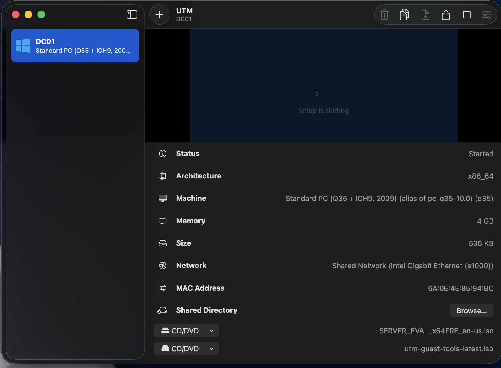

## Oct 5: Setup fails with a license terms error

- **Change:** Created DC01 (Emulate, Intel ICH9 x86_64, 4096 MiB RAM, 2 cores, 60 GB disk) and booted `SERVER_EVAL_X64FRE_en-us.iso`. Chose Windows Server 2022 Standard Evaluation (Desktop Experience).
- **Observation:** Setup said "Windows cannot find the Microsoft Software License Terms," then restarted. It happened twice.
- **Observation:** The ISO is 5,044,094,976 bytes, which looked complete.
- **Observation:** Booting from the UEFI shell showed "Press any key to boot from CD or DVD" and timed out. When I pressed a key in time, Setup loaded but the same error came back.
- **Interpretation:** Setup started but couldn't read the license terms file from the disc. Either the ISO has a problem or the emulated drive isn't reading it properly.

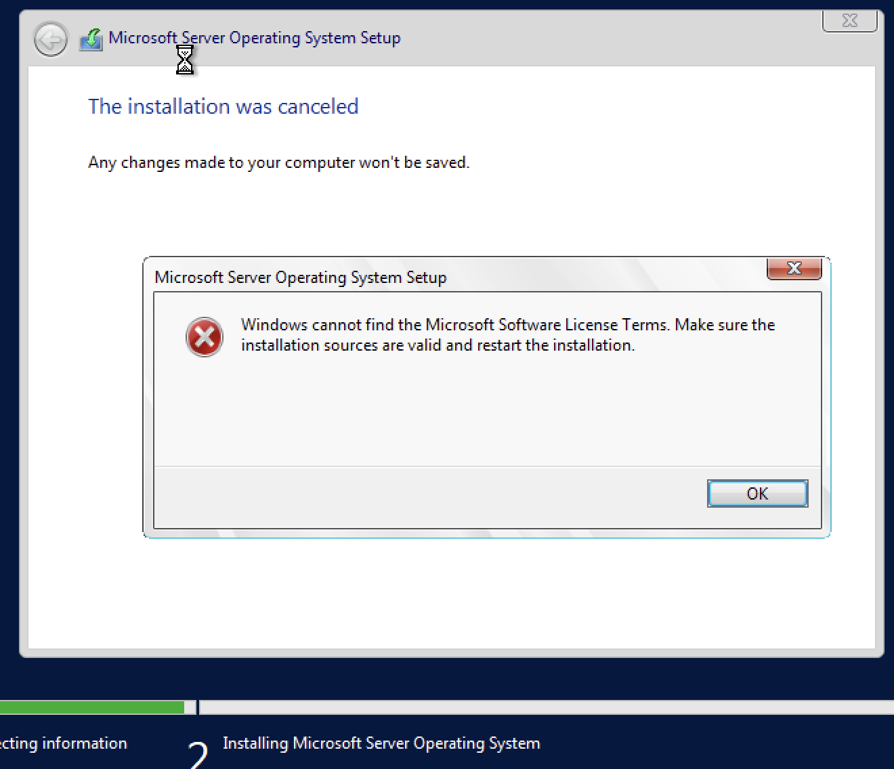
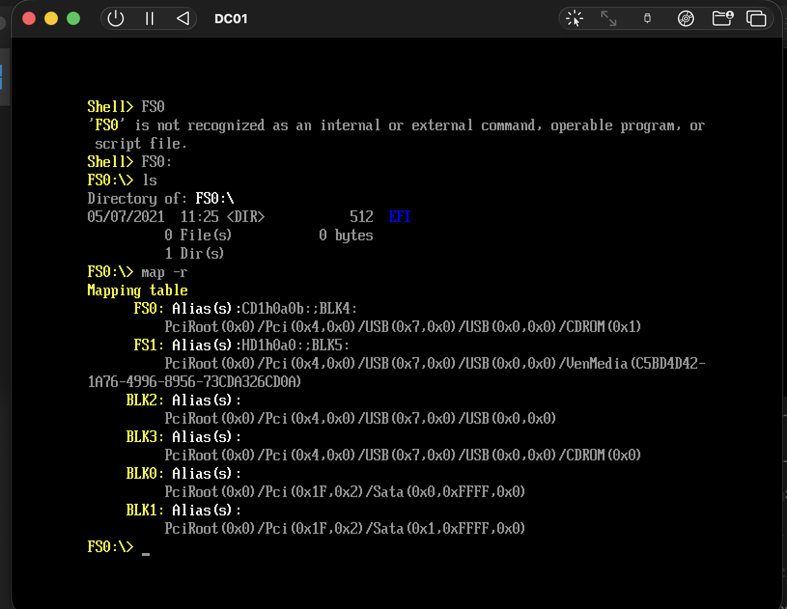

## Oct 7: Checking the ISO and attempt 3

- **Observation:** The SHA-256 of the server ISO matches the published value and the size matches exactly, so the ISO is not corrupted.
- **Observation:** `hdiutil attach` fails on both ISOs with "Resource temporarily unavailable." That points to a macOS mounting issue, not a bad ISO.
- **Change:** Re-created DC01 with SPICE tools unticked and the CD interface set to IDE (Emulate, Windows, ICH9 x86_64, 4096 MiB, 2 cores, 60 GB).
- **Observation:** Setup reached the license terms page and installed, which it hadn't done before.
- **Next step:** Custom install, then the first reboot.

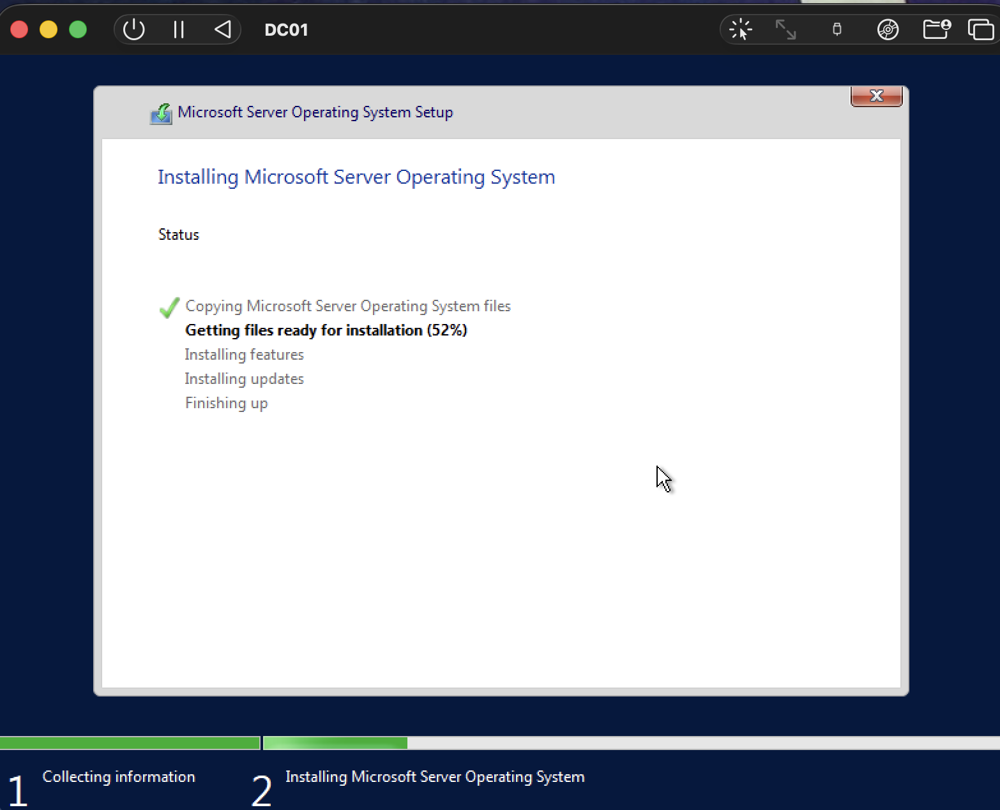

## Oct 12-13: Setup shows leftover partitions

- **Observation:** On "Where do you want to install," Drive 0 already had three partitions: System (100 MB), MSR (16 MB) and a 59.9 GB Primary with 51.0 GB free.
- **Interpretation:** The first install phase had already copied files, and the VM rebooted into the ISO instead of the disk.
- **Change:** Ejected the ISO and booted from the disk. Setup finished and asked for the Administrator password.
- **Observation:** Server Manager opened. The desktop shows Windows Server 2022 Standard Evaluation, license valid for 180 days, build 20348. Roles: 0.
- **Next step:** Make a backup before changing anything.

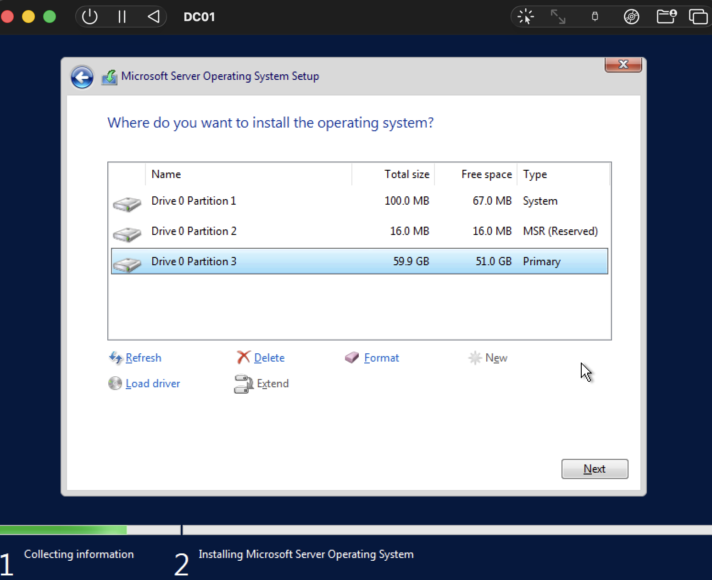
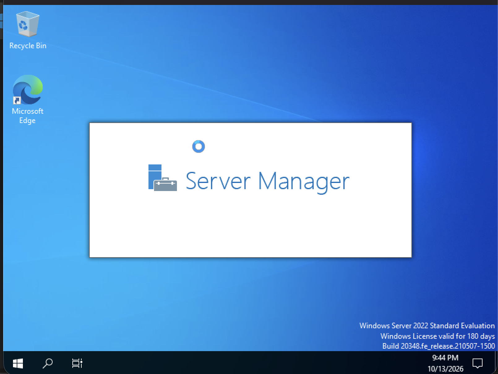

## Oct 13-14: Clean-install backup

- **Change:** Cloned DC01 as `DC01-clean-install`.
- **Rule:** Do all work in `DC01`. Never start or promote `DC01-clean-install`, and never run both at once. They share the same identity, which can cause conflicts, and they'd split my 16 GB of RAM.
- **Why:** If a later step breaks DC01 (a bad promotion, a broken network setting), I can delete it, clone the backup again, and skip the multi-hour install.

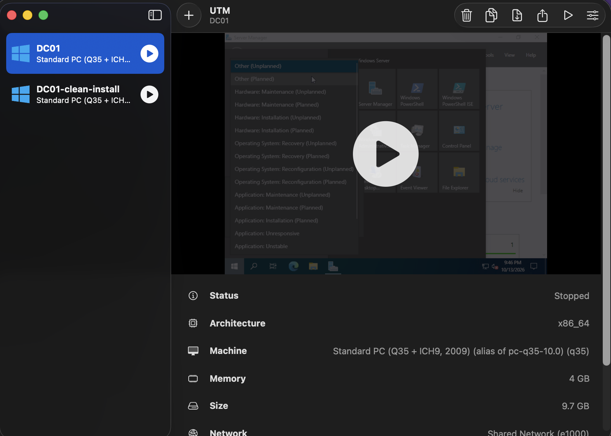

## Oct 16: Rename and static IP

- **Observation (before):** Hostname `WIN-D8D88UKV0FB`, DHCP-assigned `192.168.64.2/24`, gateway, DHCP server and DNS all `192.168.64.1`, DNS suffix `mynetworksettings.com`.
- **Change:** Renamed the server to `DC01`.
- **Change:** Disabled DHCP and set static IP `192.168.64.10/24`, gateway `192.168.64.1`, DNS `127.0.0.1`.
- **Observation:** All commands ran with no errors. `New-NetIPAddress` printed the address as `Tentative`, which is normal while Windows checks that nobody else is using it.
- **Verified:** `ipconfig /all` shows hostname `DC01`, DHCP Enabled: No, IPv4 `192.168.64.10`. Ping to the gateway: 4 sent, 4 received, 0% loss.
- **Observation:** The old DNS suffix `mynetworksettings.com` is still listed from the DHCP lease. It should change to `corp.local` after promotion.
- **Change:** Cloned DC01 as `DC01-static-ip` before installing AD DS.
- **Next step:** Install the AD DS role.

Commands used:

```powershell
Rename-Computer -NewName "DC01" -Restart
Set-NetIPInterface -InterfaceAlias "Ethernet" -Dhcp Disabled
New-NetIPAddress -InterfaceAlias "Ethernet" -IPAddress 192.168.64.10 -PrefixLength 24 -DefaultGateway 192.168.64.1
Set-DnsClientServerAddress -InterfaceAlias "Ethernet" -ServerAddresses 127.0.0.1
```

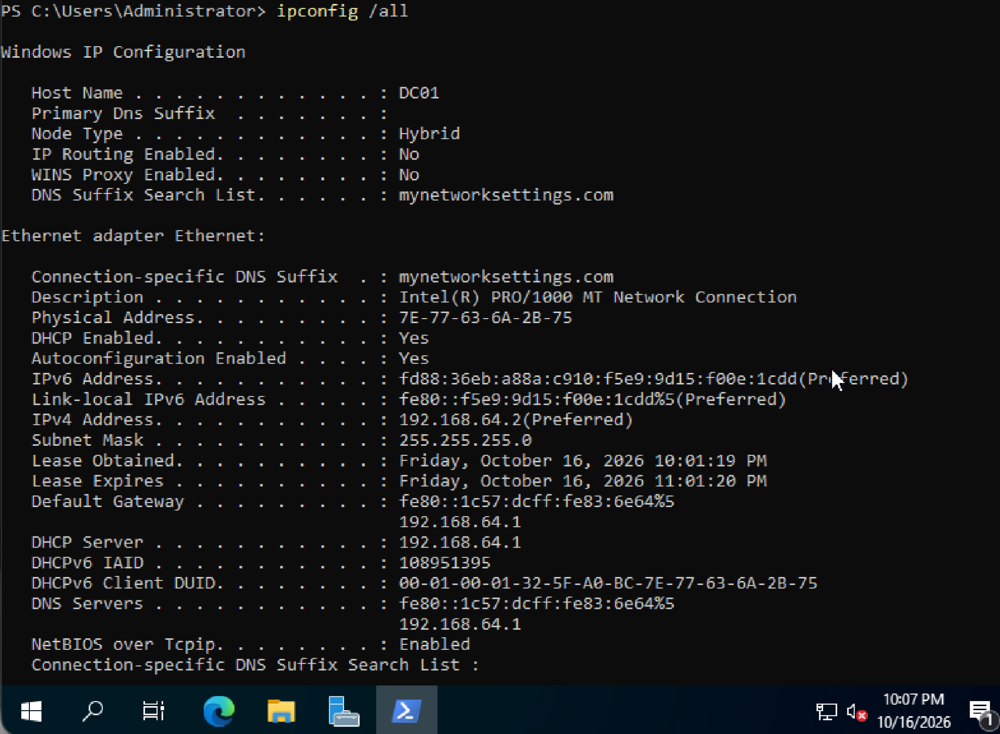
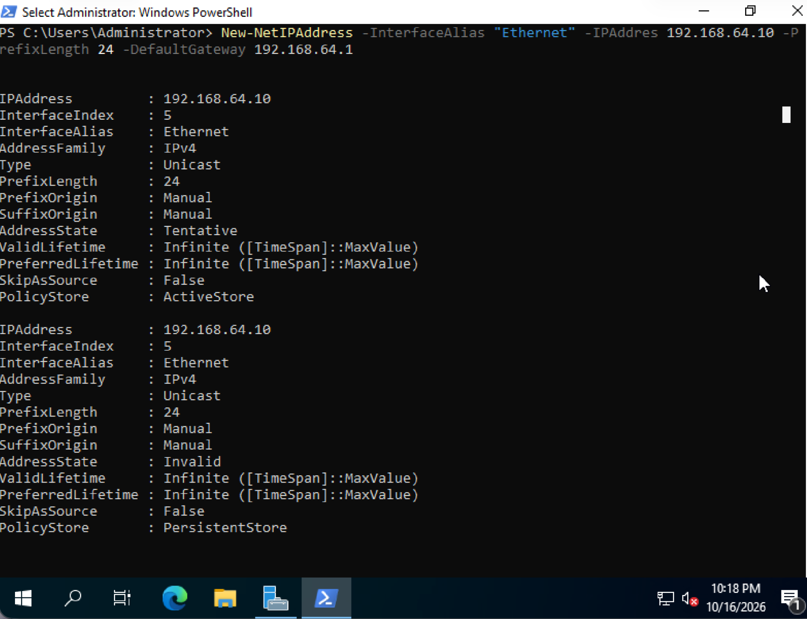
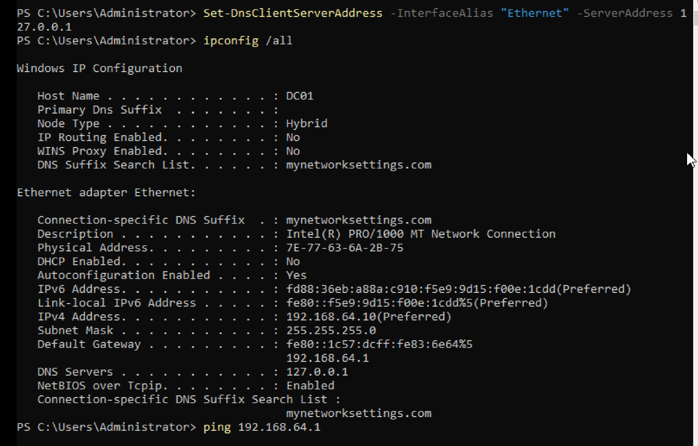
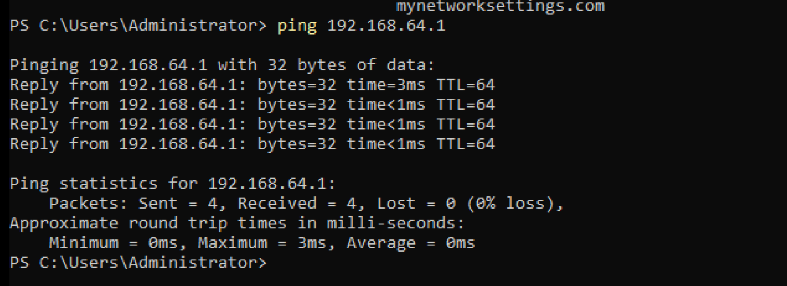
